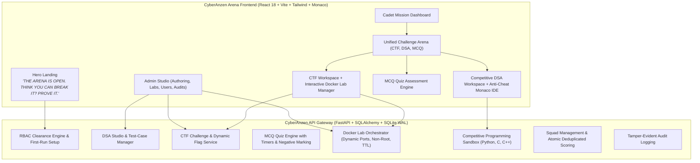

# CyberAnzen Arena — Cybersecurity CTF, Digital Forensics & Competitive Programming Platform

[](https://github.com/rddharun1089/cyberanzen-platfrom)
[-10b981.svg)](https://github.com/rddharun1089/cyberanzen-platfrom)
[](LICENSE)
[](https://github.com/rddharun1089/cyberanzen-platfrom)
[](https://github.com/rddharun1089/cyberanzen-platfrom)
[](https://github.com/rddharun1089/cyberanzen-platfrom)

> **“THE ARENA IS OPEN. THINK YOU CAN BREAK IT? PROVE IT.”**  
> *Investigate the evidence. Solve the challenge. Write the exploit. Master the code. Climb the leaderboard.*

---

## 1. Executive Overview

**CyberAnzen Arena** is an enterprise-grade, production-oriented cybersecurity CTF (Capture The Flag), digital forensics workspace, and competitive programming judge engineered under the **CyberAnzen** organization.

### Zero-Question Clean Initial Bank Architecture
Unlike legacy platforms with hardcoded question sets, CyberAnzen Arena strictly starts with an **empty question bank** (0 DSA questions, 0 MCQs, 0 CTF challenges). Administrators possess total control to author, test, and publish challenges via the **Admin Question & Challenge Studio** or generate validated dynamic templates with reproducible seeds.

---

## 2. Core Modules



1. **Public Landing Page & Authentication**: High-impact cybersecurity theme, registration, first-run Super Admin setup flow, and Granular RBAC (`super_admin`, `event_admin`, `challenge_author`, `judge_operator`, `proctor`, `auditor`, `participant`).
2. **User Mission Dashboard**: Live operational metrics, clearance badges, solved challenges breakdown, squad statistics, and quick launcher.
3. **CTF & Digital Forensics Workspace**: Dynamic flag generation, hints with point deductions, replay prevention, protected attachments, and Docker lab instance control.
4. **Interactive Docker Lab Engine**: Isolated challenge container instances per participant/squad with non-root security, dynamically allocated ports, resource quotas, and automatic expiration teardown.
5. **Competitive Programming Judge**: High-performance sandbox supporting Python 3, C (gcc), and C++ (g++) bounded by POSIX `setrlimit` (RLIMIT_CPU, RLIMIT_AS, RLIMIT_NPROC, RLIMIT_FSIZE).
6. **DSA Question Bank Studio**: Full problem authoring with sample vs. hidden test cases, starter code generation, and sandboxed reference solution validation.
7. **MCQ Quiz Engine**: Single-choice, multi-choice, negative marking, randomized options, question timers, and post-submission explanations.
8. **Parameterized Question Generator**: Deterministic template engine generating unique parameters and test cases from reproducible seeds.
9. **Event & Competition Engine**: Individual, Team, and Mixed tournament modes, scheduled windows, and leaderboard freeze controls.
10. **Squad / Team Engine**: Secret invitation codes, strict 1-squad membership, and atomic score deduplication (0 points for repeated teammate solves).
11. **Admin Control Center**: Visual Challenge Studio, Docker Lab monitoring, safe cascading user deletion (Super Admin self-deletion prevention, squad ownership promotion), and audit logs.

---

## 3. Clearance Credentials

| Role | Username | Default Passphrase | Clearance Level |
| :--- | :--- | :--- | :--- |
| **Super Administrator** | `admin` | `CyberAnzen#Admin2026!` | Highest Clearance: User Deletion, System Audits, Full Studios |
| **First-Run Wizard** | *(Dynamic)* | Custom (≥ 8 chars) | Activated automatically when no admin exists at `/setup` |

> [!NOTE]
> All passwords use cryptographic bcrypt hashing. When logged in as an Administrator (`super_admin` or `admin`), you possess an automatic **Admin Clipboard Override** that allows copying and pasting code even when a challenge is locked for exam participants.

---

## 4. Quick Start & Local Setup

### Prerequisites
- Linux / macOS / WSL2 (Ubuntu 20.04+ recommended)
- Python 3.10+ (Python 3.12 / 3.14 supported)
- Node.js 18+ & npm
- GCC and G++ (for C/C++ judging)
- Docker (optional, for interactive challenge labs)

### 1. Clone the Repository
```bash
git clone https://github.com/rddharun1089/cyberanzen-platfrom.git
cd cyberanzen-platfrom
```

### 2. Backend Setup
```bash
# Create and activate virtual environment
python3 -m venv venv
source venv/bin/activate

# Install dependencies
pip install -r backend/requirements.txt
```

### 3. Frontend Build
```bash
cd frontend
npm install
npm run build
cd ..
```

### 4. Run Server
```bash
# Start backend API (serves both REST API and compiled React SPA)
PYTHONPATH=backend ./venv/bin/uvicorn app.main:app --host 0.0.0.0 --port 8000
```
Open your browser at **http://127.0.0.1:8000**.

---

## 5. Automated Master Test Suite

The platform includes a 19-test suite covering health checks, RBAC clearance, DSA test validation, MCQ assessments, CTF flag submission, Docker lab lifecycles, squad atomic scoring, judge sandbox execution, and safe user deletion cascades:

```bash
./venv/bin/python3 scripts/run_all_tests.py
```

Expected output:
```
======================================================================
RUNNING CYBERANZEN MASTER TEST SUITE
======================================================================
19 passed in 6.4s (100% success rate)
ALL TESTS PASSED SUCCESSFULLY.
```

---

## 6. Security & Sandboxing Architecture

- **Execution Limits**: POSIX `setrlimit` restricts CPU time (RLIMIT_CPU), maximum virtual memory (RLIMIT_AS: 256MB), max subprocesses (RLIMIT_NPROC: 64), and file write quotas (RLIMIT_FSIZE: 1MB).
- **Hidden Test Privacy**: Private test inputs and expected outputs are never exposed to the frontend or student response payloads.
- **Docker Lab Isolation**: Lab containers run as non-root users with dropped capabilities (`cap_drop: ALL`), dynamic non-conflicting port allocation, and auto-cleanup workers. Host daemon sockets and host filesystems are never mounted to challenge workloads.
- **Atomic Scoring Deduplication**: Solves are verified and committed in transactional locks preventing race conditions and double-scoring across squads.

---

## 7. License

Licensed under the **MIT License**. Engineered for the CyberAnzen community.
