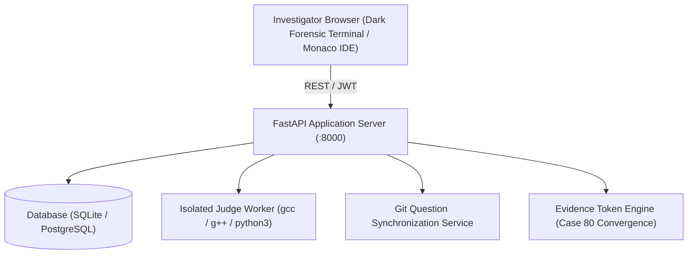

# CyberAnzen — 80-Case Crime Investigation Programming Platform

[](https://github.com/)
[](https://github.com/)
[](LICENSE)
[](https://github.com/)

A fully functional, self-hostable, open-source online programming practice platform built around 80 fictional crime-investigation narratives and digital forensics challenges.

---

## 1. System Architecture

The platform combines a forensic investigation terminal interface with an isolated judge execution engine:



### Core Components
- **Web Application:** Python FastAPI service providing role-based access control, JWT clearance authentication, challenge catalogs, and real-time execution feedback.
- **Frontend SPA:** Dark forensic-themed Single Page Application built with React 18, Vite, Tailwind CSS, Lucide icons, and the Monaco Editor (VS Code core).
- **Isolated Judge Sandbox:** Multi-tier execution sandbox for C (gcc 11), C++ (g++ 17), and Python 3. Enforces strict CPU timeouts (`RLIMIT_CPU`), virtual memory ceilings (`RLIMIT_AS`), file size caps (`RLIMIT_FSIZE`), and process isolation (`RLIMIT_NPROC`).
- **Git Question Management:** Version-controlled question repository importer with schema validation, preview mode, duplicate detection, and atomic database synchronization.
- **Evidence Token Engine:** Server-side token validation linking independently solved cases across 10 technical domains into Case 80: Master Convergence (cryptographic SHA-256 proof).

---

## 2. 80 Cases Across 10 Technical Domains

| Phase | Range | Technical Domain | Cases | Points |
|---|---|---|---|---|
| Phase I — The Archive Unlocks | 01–12 | Cybersecurity & Digital Forensics | 12 | 50 pts |
| Phase II — When the Machines Started Lying | 13–22 | AI / Machine Learning | 10 | 50–75 pts |
| Phase III — Numbers Don't Forget | 23–30 | Data Science | 8 | 75 pts |
| Phase IV — The Machines Between the Lines | 31–38 | ECE / Embedded Systems | 8 | 75 pts |
| Phase V — The Network of Things | 39–46 | IoT | 8 | 75 pts |
| Phase VI — The Ledger Never Forgets | 47–54 | Blockchain | 8 | 75–100 pts |
| Phase VII — Crime in Motion | 55–61 | Robotics | 7 | 100 pts |
| Phase VIII — Above the Ground | 62–68 | Aerospace | 7 | 100 pts |
| Phase IX — The Smallest Trace | 69–73 | Nanotechnology | 5 | 100 pts |
| Final Phase — The Pieces Meet | 74–80 | Cross-Domain Grand Crimes | 7 | 100–200 pts |
| **Total** | **01–80** | **10 Domains** | **80** | **6,350 pts** |

---

## 3. Quickstart & Local Execution

### Option A: Direct Host Execution (Recommended)

1. **Activate Virtual Environment & Install Dependencies:**
   ```bash
   python3 -m venv venv
   ./venv/bin/pip install -r backend/requirements.txt
   ```

2. **Bootstrap Database with 80 Cases:**
   ```bash
   PYTHONPATH=backend ./venv/bin/python backend/app/db/init_db.py
   ```

3. **Build the Frontend (Already pre-built in `frontend/dist`):**
   ```bash
   cd frontend && npm install && npm run build && cd ..
   ```

4. **Launch Server:**
   ```bash
   ./scripts/start_platform.sh
   # Or directly:
   PYTHONPATH=backend ./venv/bin/uvicorn app.main:app --host 0.0.0.0 --port 8000
   ```
   Open your browser at **http://localhost:8000**.

### Option B: Docker Compose Deployment
```bash
docker compose up -d --build
```
Platform healthcheck is available at `http://localhost:8000/api/health`.

---

## 4. Default Clearance Credentials

| Role | Username | Password | Access Level |
|---|---|---|---|
| **Administrator** | `lead_investigator` | `Investigator#2026!` | Full Admin Terminal, Case Management, Git Sync, Audit Logs |
| **Participant** | `cadet_forensic` | `Investigator#2026!` | Investigation Archive, Coding Workspace, Token Vault, Submissions |

---

## 5. Security & Isolated Judge Sandbox

Untrusted participant code is **never** executed inside the main web server process:
- Each submission is written to a unique, ephemeral directory (`/tmp/judge_run_*`) that is destroyed immediately after evaluation.
- Linux `resource.setrlimit` strictly caps CPU time (3s max), virtual memory address space (256 MB), and file output size (5 MB).
- Fork bomb protection via process limit (`RLIMIT_NPROC: 30`).
- Core dump generation is completely disabled (`RLIMIT_CORE: 0`).
- Hidden test inputs and expected outputs are strictly segregated from participant-facing API responses. Only test index and verdict status are reported.

---

## 6. Automated Test Suite (29/29 Passing)

Run the full automated test suite:
```bash
./scripts/run_all_tests.py
# Or:
./venv/bin/pytest tests/ -v
```

### Test Coverage Summary:
- `tests/test_extraction.py`: Verifies extraction of all 80 cases, title parity, and mathematical points sum.
- `tests/test_schema.py`: Verifies metadata schema, starter code templates, and test manifests for all 80 questions.
- `tests/test_judge_sandbox.py`: Verifies C, C++, and Python 3 compilation, execution, TLE timeouts, CE diagnostics, and test privacy.
- `tests/test_auth_rbac.py`: Verifies bcrypt hashing, JWT validation, and RBAC endpoint protection.
- `tests/test_evidence_engine.py`: Verifies token derivation, verification, and Case 80 cryptographic convergence.
- `tests/test_git_sync.py`: Verifies question repository scanning, duplicate detection, and schema validation.
- `tests/test_api_integration.py`: End-to-end API integration tests for cases, submissions, verdicts, and stats.

---

## 7. Reports & Documentation

- **Source Inventory Report:** [`reports/SOURCE_INVENTORY.md`](file:///home/Files/LXD-Share/cyberanzen-program/reports/SOURCE_INVENTORY.md)
- **Validation & Discrepancy Report:** [`reports/VALIDATION_REPORT.md`](file:///home/Files/LXD-Share/cyberanzen-program/reports/VALIDATION_REPORT.md)
- **Architecture Specifications:** [`reports/ARCHITECTURE_REPORT.md`](file:///home/Files/LXD-Share/cyberanzen-program/reports/ARCHITECTURE_REPORT.md)
