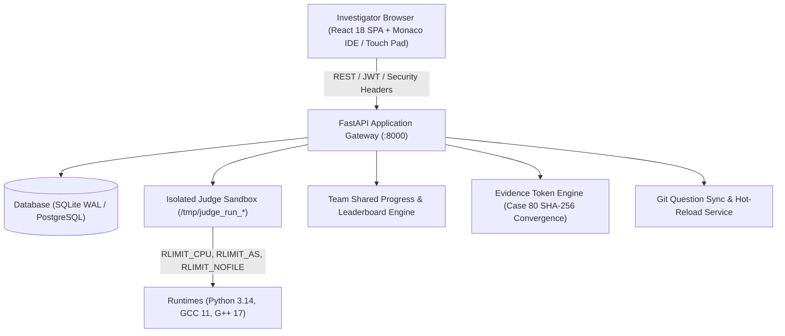

# Enigmatrix — Crime Investigation & Digital Forensics Programming Platform

[](https://github.com/)
[-10b981.svg)](https://github.com/)
[](LICENSE)
[](https://github.com/)
[](https://github.com/)
[](https://github.com/)

A modern, open-source competitive programming and digital forensics platform powered by **80 connected cybercrime cases** across **10 technical domains**. Features an isolated sandbox judge worker (supporting Python 3, C, and C++), team-based competitions, live leaderboards, strict exam anti-cheat controls, complete administrative management, and an interactive cryptographic evidence token graph.

---

## Table of Contents

1. [Default Clearance Credentials](#1-default-clearance-credentials)
2. [Platform Architecture](#2-platform-architecture)
3. [The 80 Forensic Cases (6,350 Points)](#3-the-80-forensic-cases-6350-points)
4. [Key Platform Features](#4-key-platform-features)
5. [Free Cloud & Production Hosting Guides](#5-free-cloud--production-hosting-guides)
   - [Option A: Free Cloud Hosting on Render](#option-a-free-cloud-hosting-on-render)
   - [Option B: Free Cloud Hosting on Railway](#option-b-free-cloud-hosting-on-railway)
   - [Option C: Free Cloud Hosting on Fly.io](#option-c-free-cloud-hosting-on-flyio)
   - [Option D: Oracle Cloud Free Tier / Ubuntu VPS (Nginx + SSL)](#option-d-oracle-cloud-free-tier--ubuntu-vps-nginx--ssl)
   - [Option E: Docker & Docker Compose](#option-e-docker--docker-compose)
   - [Option F: Local Bare-Metal Setup](#option-f-local-bare-metal-setup)
6. [Environment Variables Reference](#6-environment-variables-reference)
7. [Automated Master Test Suite (37/37 Passing)](#7-automated-master-test-suite-3737-passing)

---

## 1. Default Clearance Credentials

When you clone the repository and start the server, the database auto-bootstraps automatically—creating all tables, seeding default administrative & participant accounts, and ingesting all 80 Forensic Cases with 0 manual steps required.

| Role | Username | Password | Permissions & Clearance |
| :--- | :--- | :--- | :--- |
| **Super-Administrator** | `admin` | `Enigmatrix#Admin2026!` | Full Admin Panel, User Deletion, Case Control, Anti-Cheat Override, Team Admin |
| **Lead Investigator** | `lead_investigator` | `Investigator#2026!` | Admin Clearance, Evidence Inspection, Clipboard Lockdown Controls |
| **Forensic Cadet** | `cadet_forensic` | `Investigator#2026!` | Participant Workspace, Team Challenges, 80 Problems, Token Vault |

> [!NOTE]
> All passwords use cryptographic bcrypt hashing. When logged in as an Administrator (`admin` or `lead_investigator`), you possess an automatic **Admin Clipboard Override** that allows copying and pasting code even when a challenge is locked for exam participants.

---

## 2. Platform Architecture



### Core Technology Stack
- **Backend API**: Python FastAPI (asynchronous ASGI), Pydantic v2 validation, SQLAlchemy ORM with SQLite (WAL mode) and PostgreSQL support.
- **Frontend SPA**: React 18, Vite, Tailwind CSS, Monaco Editor (VS Code engine), Lucide forensic icons, and responsive mobile Touch Pad code editor.
- **Judge Sandbox**: Non-root subprocess isolation with strict Linux kernel resource limits (`setrlimit`), output truncation (1MB), and temporary chroot/scratch cleanup.
- **Security & Hardening**: Defense-in-depth security headers (`X-Content-Type-Options: nosniff`, `X-Frame-Options: SAMEORIGIN`, CSP, Permissions-Policy), 5MB upload limiter, submission rate-limiting cooldowns, and brute-force IP lockout.

---

## 3. The 80 Forensic Cases (6,350 Points)

The platform includes **80 interconnected forensic cases** organized into 10 domains across 10 progressive phases:

| Phase | Cases | Domain | Points Each | Phase Total | Key Investigation Skills |
| :--- | :--- | :--- | :--- | :--- | :--- |
| **Phase I** | 01–12 | Cybersecurity & Digital Forensics | 50 pts | 600 pts | Log timeline reconstruction, impossible travel detection, packet reassembly, beaconing analysis, header forgery |
| **Phase II** | 13–22 | AI / Machine Learning | 50–75 pts | 525 pts | Adversarial perturbation, model poisoning detection, centroid outlier extraction, class-imbalance analysis |
| **Phase III** | 23–30 | Data Science | 75 pts | 600 pts | Z-score anomaly ranking, supply-chain tracking, missing sensor interpolation, Pearson correlation, rolling statistics |
| **Phase IV** | 31–38 | ECE / Embedded Systems | 75 pts | 600 pts | GPIO state transition decoding, UART hex frame extraction, FFT discrete frequency analysis, topological dependency sorting |
| **Phase V** | 39–46 | Internet of Things (IoT) | 75 pts | 600 pts | Smart home telemetry cross-referencing, unauthorized valve actuation detection, replay nonce detection, priority command queues |
| **Phase VI** | 47–54 | Blockchain & Smart Contracts | 75–100 pts | 650 pts | Cryptographic block verification, Merkle proof tree validation, double-spend detection, DAO vote deduplication |
| **Phase VII** | 55–61 | Robotics | 100 pts | 700 pts | Dijkstra shortest-path navigation, Euclidean trajectory deviation, assembly FSM validation, swarm collision priority resolution |
| **Phase VIII** | 62–68 | Aerospace | 100 pts | 700 pts | Altitude telemetry bounds checking, flight recorder gap recovery, Caesar cipher decoding, radar injection separation |
| **Phase IX** | 69–73 | Nanotechnology | 100 pts | 500 pts | Multivariable batch contamination, moving mean + 3σ spike detection, clean-room parameter envelope verification |
| **Final Phase** | 74–80 | Cross-Domain Grand Crimes | 100–200 pts | 875 pts | Multi-vector heist correlation, satellite dependency graphs, calibration ransomware recovery, Case 80 Canonical Convergence |
| **TOTAL** | **CASE 01–80** | **10 Technical Domains** | — | **6,350 pts** | **100% Tested & Validated (80/80 ACCEPTED)** |

---

## 4. Key Platform Features

### 1. Isolated Sandbox Judge Engine
- **Supported Languages**: Python 3 (`python3`), C++ (`g++ -O2 -std=c++17`), and C (`gcc -O2 -std=c11`).
- **Resource Enforcement**:
  - `RLIMIT_CPU`: Strict CPU runtime timeout (default: 2.0s).
  - `RLIMIT_AS`: Virtual memory ceiling (default: 256MB).
  - `RLIMIT_NPROC`: Fork bomb mitigation (max 30 child processes).
  - `RLIMIT_NOFILE`: File descriptor leak mitigation (max 64 open files).
  - `RLIMIT_CORE`: Core dumps disabled (0 MB).
- **Public & Hidden Test Suites**: Sample test cases allow participants to test their code interactively; hidden test cases validate edge cases without leaking data.

### 2. Strict Exam Anti-Cheat Lockdown & Admin Override
- Administrators can lock down clipboard access globally for all 80 problems, per-domain, or per-case.
- **Exam Mode for Participants**: Blocks `Ctrl+C`, `Ctrl+V`, `Ctrl+X`, `Ctrl+Shift+C`, `Shift+Insert`, right-click context menus, and browser paste extensions.
- **Admin Clipboard Override**: Administrators bypass all clipboard restrictions automatically—allowing staff to paste test cases, verify reference solutions, or perform maintenance.

### 3. Team-Based Challenge System
- Authenticated users can create teams, configure team names, and become team owners.
- **Cryptographic Invitations**: Auto-generates secure, random invitation codes and shareable links (`/join/TOKEN`).
- **Shared Team Progress**: When any team member submits an accepted solution, points and evidence tokens are awarded to the team atomically. Duplicate submissions do not award duplicate points.
- **Team Leaderboard**: Real-time ranking of teams by solved challenges, total points, and earliest completion timestamp.

### 4. Complete User Deletion for Administrators
- Administrative interface allowing permanent account deletion.
- Displays user statistics, submission count, and team memberships before confirmation.
- Confirmation dialog requires typing the target username to prevent accidental deletion.
- Enforces critical safety constraints: prevents self-deletion and protects the last active super-administrator.
- Foreign-key cascade safety cleans up submissions, tokens, and memberships without corrupting shared team data.

### 5. Cyber-Themed UI & Mobile Touch Pad
- Polished, responsive dark HUD interface (Navy `#070b12`, Electric Cyan `#00f0ff`, and Violet accents).
- **Mobile Touch Pad Editor**: Dedicated mobile coding interface with line numbers, 4-space tab indentation, and layout collapse prevention for phones and tablets.
- **Interactive Evidence Graph**: Visual node graph linking unlocked evidence tokens across cases leading to Case 80's final cryptographic SHA-256 flag.

---

## 5. Free Cloud & Production Hosting Guides

### Option A: Free Cloud Hosting on Render

[Render](https://render.com/) offers free Web Service hosting. Because the project includes pre-built static assets and automatic database bootstrap, it can be deployed in a single service.

1. **Push your code to GitHub**.
2. **Log in to Render** and click **New + > Web Service**.
3. **Connect your GitHub repository**.
4. Configure the settings:
   - **Name**: `cyberanzen-platform`
   - **Region**: Choose the closest region (e.g., Oregon, Frankfurt, Singapore).
   - **Runtime**: **Docker** (Render will automatically detect `Dockerfile`).
   - **Plan**: **Free**
5. Add **Environment Variables**:
   ```env
   SECRET_KEY=generate-a-random-32-character-secret-key-here!
   PYTHONUNBUFFERED=1
   JUDGE_TIMEOUT_SEC=3.0
   JUDGE_MEMORY_LIMIT_MB=256
   ```
6. Click **Create Web Service**. Render will build the Docker container and deploy your platform. Your app will be live at `https://your-service-name.onrender.com`.

---

### Option B: Free Cloud Hosting on Railway

[Railway](https://railway.app/) provides free trial credits and seamless Docker deployment.

1. **Log in to Railway** and click **New Project > Deploy from GitHub repo**.
2. Select your repository.
3. Railway automatically detects `Dockerfile` and builds the application.
4. In the **Variables** tab, add:
   ```env
   SECRET_KEY=generate-a-random-32-character-secret-key-here!
   PORT=8000
   ```
5. In the **Settings** tab, under **Networking**, click **Generate Domain**.
6. Your platform will be accessible immediately at your generated Railway URL.

---

### Option C: Free Cloud Hosting on Fly.io

[Fly.io](https://fly.io/) allows running small Docker applications on their free allowance.

1. Install the Fly CLI and authenticate:
   ```bash
   curl -L https://fly.io/install.sh | sh
   fly auth login
   ```
2. Initialize and deploy from your project directory:
   ```bash
   fly launch --name cyberanzen-platform --no-deploy
   ```
3. Set your secret key:
   ```bash
   fly secrets set SECRET_KEY="generate-a-random-32-character-secret-key-here!"
   ```
4. Deploy:
   ```bash
   fly deploy
   ```
5. Open your application:
   ```bash
   fly open
   ```

---

### Option D: Oracle Cloud Free Tier / Ubuntu VPS (Nginx + SSL)

Oracle Cloud offers two Always-Free AMD/ARM compute instances with generous memory and bandwidth.

1. **SSH into your Ubuntu server**:
   ```bash
   sudo apt-get update && sudo apt-get install -y git python3 python3-venv python3-pip gcc g++ build-essential nginx certbot python3-certbot-nginx
   ```
2. **Clone the repository**:
   ```bash
   git clone https://github.com/rddharun1089/cyberanzen-platform-Dmoj.git
   cd cyberanzen-platform-Dmoj
   ```
3. **Setup Python Virtual Environment**:
   ```bash
   python3 -m venv venv
   ./venv/bin/pip install --upgrade pip
   ./venv/bin/pip install -r backend/requirements.txt
   ```
4. **Create a Systemd Service** (`/etc/systemd/system/cyberanzen.service`):
   ```ini
   [Unit]
   Description=Enigmatrix CyberAnzen Platform Server
   After=network.target

   [Service]
   User=ubuntu
   WorkingDirectory=/home/ubuntu/cyberanzen-platform-Dmoj
   Environment="PYTHONPATH=backend"
   Environment="SECRET_KEY=your-production-secret-key-32ch-min!"
   ExecStart=/home/ubuntu/cyberanzen-platform-Dmoj/venv/bin/uvicorn app.main:app --host 127.0.0.1 --port 8000 --workers 4
   Restart=always
   RestartSec=5

   [Install]
   WantedBy=multi-user.target
   ```
5. **Enable and Start Service**:
   ```bash
   sudo systemctl daemon-reload
   sudo systemctl enable cyberanzen
   sudo systemctl start cyberanzen
   ```
6. **Configure Nginx Reverse Proxy** (`/etc/nginx/sites-available/cyberanzen`):
   ```nginx
   server {
       server_name yourdomain.com;

       location / {
           proxy_pass http://127.0.0.1:8000;
           proxy_set_header Host $host;
           proxy_set_header X-Real-IP $remote_addr;
           proxy_set_header X-Forwarded-For $proxy_add_x_forwarded_for;
           proxy_set_header X-Forwarded-Proto $scheme;
       }
   }
   ```
   Enable site and obtain free SSL:
   ```bash
   sudo ln -s /etc/nginx/sites-available/cyberanzen /etc/nginx/sites-enabled/
   sudo nginx -t && sudo systemctl reload nginx
   sudo certbot --nginx -d yourdomain.com
   ```

---

### Option E: Docker & Docker Compose

Deploy the complete platform with a single command:

```bash
docker compose up -d --build
```

- Platform will be accessible at `http://localhost:8000`.
- Health check available at `http://localhost:8000/api/health`.
- Data is persisted via the `cyberanzen-data` Docker volume.

---

### Option F: Local Bare-Metal Setup

1. **Install Dependencies**:
   ```bash
   python3 -m venv venv
   ./venv/bin/pip install -r backend/requirements.txt
   cd frontend && npm install && npm run build && cd ..
   ```
2. **Start Backend Server**:
   ```bash
   PYTHONPATH=backend ./venv/bin/uvicorn app.main:app --host 0.0.0.0 --port 8000
   ```
3. **Start Frontend Dev Server (Optional, for development)**:
   ```bash
   cd frontend && npm run dev
   ```
   Open `http://localhost:8000` (or `http://localhost:5173` for Vite hot-reloading).

---

## 6. Environment Variables Reference

| Variable | Default Value | Description |
| :--- | :--- | :--- |
| `SECRET_KEY` | `enigmatrix-forensic-secret-key-32-chars-long!` | JWT HMAC-SHA256 signature key |
| `DATABASE_URL` | `sqlite:///./cyberanzen.db` | SQLAlchemy database connection URI (SQLite or PostgreSQL) |
| `JUDGE_TIMEOUT_SEC` | `3.0` | Default execution timeout in seconds |
| `JUDGE_MEMORY_LIMIT_MB` | `256` | Maximum virtual memory allocated to judged subprocesses |
| `JUDGE_MAX_OUTPUT_BYTES`| `1048576` (1 MB) | Maximum standard output captured from user code |
| `JUDGE_TEMP_DIR` | `/tmp/enigmatrix_judge` | Root directory for ephemeral sandboxes |
| `ACCESS_TOKEN_EXPIRE_MINUTES` | `10080` (7 days) | JWT expiration duration in minutes |

---

## 7. Automated Master Test Suite (37/37 Passing)

Run the full automated test suite using pytest:

```bash
python3 scripts/run_all_tests.py
# Or:
PYTHONPATH=backend ./venv/bin/pytest tests/ -v
```

### Test Suite Breakdown:

| Test File | Tests | Coverage Description |
| :--- | :---: | :--- |
| `tests/test_all_80_cases.py` | 2 | Verifies all 80 database cases are validated, have authentic test cases, and pass judge sandbox evaluation |
| `tests/test_api_integration.py` | 13 | Health check, login, case filtering, privacy boundaries, sample testing, submission verdicts, evidence graph, clipboard toggles |
| `tests/test_auth_rbac.py` | 3 | Bcrypt password hashing, JWT expiration, RBAC admin route protection |
| `tests/test_evidence_engine.py` | 3 | Token derivation, verification, and Case 80 deterministic cryptographic convergence |
| `tests/test_extraction.py` | 2 | Verifies source DOCX existence, case inventory, and mathematical points sum (6,350 pts) |
| `tests/test_git_sync.py` | 3 | Question repository scanning, invalid format detection, repository metadata |
| `tests/test_judge_sandbox.py` | 7 | Python, C, C++ sandbox compilation, TLE timeout, CE diagnostics, hidden test privacy |
| `tests/test_schema.py` | 2 | Starter code templates validation, JSON metadata schemas across all 80 questions |
| `tests/test_team_system.py` | 1 | Team lifecycle, cryptographic invites, shared progress, atomic non-duplicate scoring |
| `tests/test_user_deletion.py` | 1 | Complete user deletion, super-admin protection, self-deletion prevention, foreign key cascade |
| **Total** | **37** | **100% Passed (37 / 37)** |

---

## License

This project is licensed under the MIT License — see the [LICENSE](LICENSE) file for details.
